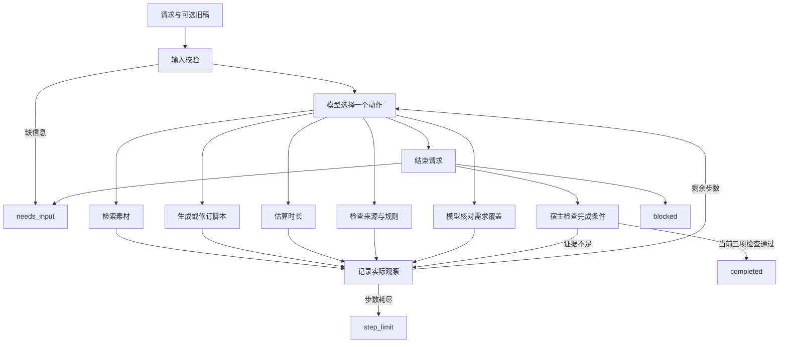

# 02 · 方案与动态决策

## 当前v7.3.1：证据按版本复算

Agent写稿与审核策略延续v7.3。本轮在运行元数据和检查点中记录 `tool_contracts.search_materials=id_first_v2`，manifest随结果保存。验证器根据明确契约或已知历史版本选择检索算法，不根据保存结果试探哪个算法能通过。未标版本的原始记录和v7使用keyword_v1；v7.1–v7.3使用id_first_v2。旧算法来自Git历史e624c5a的src/tools.py，仅用于复算。未知契约、版本冲突及篡改结果仍报错。

`python -m scripts.verify_evidence` 默认检查当前四类证据与原始示例，另写时间戳报告，保留旧验证结果。当前主证据见[索引](../examples/current/evaluation.md)，具体修复和验证见[报告](../evaluations/submission-v7.3.1-20261106/README.md)。

## v7.3：逐段动作与对白

创作模式新稿使用format_version=3。每镜保留场景概述，staging按beat写action、camera、sound和min_seconds；文案块speaker明确人物或旁白。每段时长取声音、屏幕阅读、展示停留、动作最低时长的最大值，各段顺序累计；无对白动作段也有明确时长。摄影说明与人物名字不进入配音。

src/staging.py将原稿与工具估时投影为时间行，网页和Markdown导出共用。新增动作表面纳入原有语义审核，修改动作使当前稿哈希变化；没有增加审核调用阶段。v1/v2仍可读取与复算，旧稿不补造逐段动作；strict继续生成v2。本轮设计与验证见[动作分镜报告](../evaluations/staging-v7.3-20261106/README.md)。

## 历史v7：自然旁白

v7先组织完整口头讲述，再拆分镜与引用。src/listening.py按镜头和beat顺序提取voice/both，排除screen、标题、画面与备注。现有需求审核接收同一投影，写稿、估时、事实、审核与修订循环不增加阶段。网页和保存产物共用提取逻辑；旧稿声画未知时标注合并文案。app_version来自后台并写入运行元数据。 见[v7实际报告](17-v7-natural-voice.md)。

## 历史v6增量：标题与调用效率

creative 决策输入移除 strict 的通用标题/画面/连接语示例，模型从当前需求的对象、场景或看点提炼标题，仍保留用户指定标题。历史输入压缩为动作、理由与结果摘要；完整当前稿、当前检查、原始请求和已检索素材仍提供，完整Trace仍落盘。

模型选择 `check_requirements` 时，宿主补齐或复用同稿的本地时长/规则检查，规则缓存同时绑定已检索ID集合。真实调用的参数和结果存入该步骤的 `preflight_checks`。如果确定性检查失败，先把反馈交回模型；通过后再用独立上下文进行模型需求审核。模型仍根据结果决定修订、补查或结束；单独估时/查规则动作保留供诊断。

Codex子进程默认 `CODEX_REASONING_EFFORT=medium`，不修改全局模型与配置。v7.2 在使用内置服务且能解析模型时隔离无关个人工具配置，显式保留模型和服务档位；自定义供应商或 profile 继续继承配置，可用 `CODEX_INHERIT_CONFIG=1` 主动继承。决策输入压缩重复检查明细，独立审核仍使用完整依据。

每次 Codex 调用遇到超时、服务繁忙或流中断时最多恢复一次，整个任务最多额外恢复两次。同样的当前状态重新请求模型，不重放业务工具；各次尝试分别记录阶段、耗时、事件计数和脱敏错误信号。上限仍为12决策步，每步至多决策与审核两次调用，另加最多两次恢复尝试；每调用默认180秒。审核恢复失败就保存草稿并明确结束，不再追加决策调用。全部完成条件继续保留。

检查点只保存最近完整步骤；审核/恢复阶段的网页状态不会把尚未写入Trace的检查结果冒充完整证据。取消后不再启动新的审核或恢复。详见 [v6报告](16-v6-titles-latency.md)。

## v5继承能力：可改写的依据与声画节拍

新稿使用 `format_version=2`。`text` 是公开表达，`source_id/fact_id` 指向检索到的资料；宿主从素材库提取准确原句保存为 `citations[].quote`。创作模式允许缩写、改写和翻译，每条带来源的文案仍须在语义审核中得到该原文支持。来源身份验证与语义支持分开，既避免逐字照抄阻碍创作，也保留事实依据。strict 模式和旧稿继续逐字核对。

每镜 `purpose` 说明信息用途，`visual` 给出实际画面和动作；只有公开标题、画面和文案进入品牌用语检查。purpose与editor_notes不进入视频。生成指引优先用户要求的功能范围、语言、场景和顺序，让镜头传递具体内容，修订时保留未受影响部分。

文案块新增三个字段：

|字段|含义|
|---|---|
|channel|voice只朗读；screen只显示；both同一句声画同步|
|beat|1–8整数，同一拍同步、不同拍顺序播放|
|display_seconds|该屏幕块最低展示时间，纯旁白填0|

同拍旁白与屏幕文字分别估算，取较大值；同屏多段文字全部计入阅读量，多个旁白块顺序朗读。不同拍累计，再与镜头hold_seconds和最短2秒比较。中文采用资料规则4字/秒，英文2.5词/秒，加0.5秒停顿，向上取整0.1秒；结果给出每拍起止、旁白预算、阅读预算和末尾画面保持。它是剪辑规划估计，不是配音测量。网页和Markdown展示每条文字的频道与时间，并将来源原文提供给创作者核对。

旧稿没有版本号时完全保留旧工具计算分支。已有50份v4.1记录在新代码下复算无差异；所有旧稿可读取和修订。12步上限、当前稿三项检查及异常检查点保存机制保持。详细优化与真实配对结果见 [v5效果报告](15-v5-effective-scripts.md)。

以下v4.1/v4/v3小节保留实现演进背景。

## v4.1 审稿备注与验收补强

新增可选 `script.editor_notes`，供创作者核对删改原因和资料缺口，网页与 Markdown 单独展示，不进入视频也不计入时长。真实模型结构化协议要求新稿提供该字段，没有备注时为空字符串；本地验证继续接受没有此字段的旧稿。

公开标题、画面、旁白/字幕仍按原规则核对。备注可引用“已删除的错误说法”以解释处理，不因此把它认定为产品事实；备注不能充当来源，也不能替代应在视频中出现的功能介绍。备注修改同样改变稿件哈希并使旧检查失效。语义审核会检查解释与实际修改是否对应，但仍有模型误判边界。

批量验收 `check_case` 不再按版本名白名单决定是否检查需求核对，当前完成结果一律须具备有效、通过且绑定当前稿的核对。宿主完成门禁仍额外绑定原请求。此前 v4 宿主门禁没有这个版本遗漏，问题出在验收辅助程序。

## v4 有限修复

需求审核现在同时获得绑定当前稿件与时长要求的 `duration_check`，读取每镜实际估时和总长；`hold_seconds`只表示最低展示时间，0表示不额外延长。过期稿件、其他目标秒数或模式的估时不会作为可信上下文传入。总长达标仍不免除内容覆盖、事实和节奏审核；宿主不强制修改模型结论。

CLI与网页通过 `src/recording.py` 共用记录边界：在调用前以及每个已完成步骤后原子替换检查点；正式结果的多个文件依次保存，最后写完成标记。意外异常保存此前已记录状态并返回未完成。服务重启只恢复已退出进程的检查点，不自动重跑模型、不接管活跃任务。磁盘完全不可写时不能承诺保存成功。

Codex临时目录清理与有效响应处理分离；清理失败作为warning保留，不抹去已获得的动作，也不遮蔽原始调用错误。每次调用使用独立call_id诊断文件，与Trace对应。详见 [v4修复报告](10-finite-v4-report.md)。

## 架构

`src/agent.py` 管理状态与上限，`src/providers.py` 接真实模型，`src/tools.py` 执行业务工具，`src/mock.py` 是单独标注的离线桩。项目未使用第三方 Agent 框架。

## 模型在决定什么

模型每次收到请求、当前稿件、已检索资料、最近检查结果和实际历史，输出一次 JSON 动作。动作包括检索、写稿、估时、查规则、核对需求和结束。检索查询、镜头组合、引用事实、镜头停留时间与后续动作均来自模型响应。

宿主执行所选动作、校验参数和阻止无证据完成；本地预检查与一次传输超时恢复属于执行框架。脚本怎么改、查询怎么改、何时说明缺口仍由模型依据观察决定。Mock 有固定分支，明确只作离线流程验证。

若模型选错工具、参数非法或试图提前完成，错误成为下一轮的观察；达到步数上限停止。Codex超时可在上述全局预算内恢复一次，仍失败或其他模型错误则明确未完成；不静默降级为 Mock。

## 本地网页入口

`src/web.py` 使用 Python 标准库 HTTP 服务，后台线程运行与 CLI 相同的 `Agent`。`on_event` 回调在模型调用前和实际动作完成后提供深拷贝快照；前端每 900ms 查询当前状态，展示当前稿、检查与 Trace。页面不生成虚构步骤、不替模型选择动作。

只监听 `127.0.0.1`，写请求检查 Host、Origin 和服务启动时生成的 token；只提供明确列出的静态文件和结果下载。一次只接受一个运行。停止通过事件标记生效：等待本次模型调用返回后，不再执行工具或下一次模型调用。服务重启只恢复已保存结果，不恢复进行中的决策。

网页历史和 CLI 使用相同的六类产物；`outputs/web/` 保留原始输入和实际返回。最近列表最多展示 32 次，磁盘历史不会自动清除。静态前端无框架、无构建步骤、无第三方运行依赖。

## 三个工具

1. **search_materials**：对指定产品执行本地关键词检索，按匹配得分排序，最多返回五条。返回原文、来源 ID、事实 ID 和版本。产品范围由原请求绑定，模型只提供 query。不是向量检索；同义词能力有限，模型可改写查询。
2. **estimate_duration**：从实际文字与声画节拍计算，不能由模型填写总时长。v2公式见本页顶部；旧格式沿用4单位/秒的串行估算以保持历史可复现。
3. **check_rules**：检查引用ID、实际原文与品牌规则。v2创作模式枚举全部公开文案待语义核对，支持改写/翻译；旧格式和strict维持逐字检查。所有来源原文随检查结果传给审核模型。

## 需求覆盖核对（修复版）

`check_requirements` 通过同一模型适配器发起额外一次结构化调用，传原始需求、当前稿件及绑定当前稿的实际规则检查结果，不传写稿历史或旧核对结论。规则检查中的 citations 提供已核对的原文及来源，避免审核因看不到事实依据而误拒绝。无匹配当前稿的检查时传 null。核对返回各项原文要求、met/unmet/uncertain、稿件证据或缺口及摘要。宿主检查四个输入字段均有覆盖、要求摘自原文、条目格式有效，并绑定请求和稿件哈希。

核对失败作为真实观察回到决策循环，模型再选择修订、请求补充或停止。写稿模型不能在动作参数中自行填入“通过”结果。此机制仍可能漏拆要求或误判，使用的是同一后端的新上下文，不是独立模型共识或形式化语义证明。Mock 只返回明确标注的固定核对桩。

## 有边界的创作表达（v3）

旧版严格模式保留。v3 creative在同一次独立需求审核中增加expressions与pacing：宿主枚举所有公开表面，审核分别给出普通表达、资料支持声明、无支持声明、不确定。宿主验证位置/原文完整对应与来源存在性，资料支持声明必须引用检索事实。是否真正被事实蕴含仍由模型判断，不把ID存在当作机械语义证明。

独立审核不读写稿历史与自述，仍使用同一模型后端，存在相关错误。漏审、重复位置、伪造引用、无支持声明或不确定都会阻止完成。pacing检查空镜和重复事实凑时长，但没有TTS或成片评分。

`src/revisions.py`在每次写稿后记录前后哈希、索引对齐的字段差异、保留镜头/文案块数，以及修订前真实失败检查。画面或顺序改变时索引不代表同一个语义镜头。该记录帮助核对针对性修订，不声称证明模型内部因果推理。

素材本身应由业务方核准。逐字事实引用可机械核对；创作表达的语义审核可能误判。二者均不证明资料在现实世界正确，当前数据都是虚构产品信息。

## 检查与状态

- 每次 write_script 后，旧时长、旧规则与旧需求核对全部失效。
- 三项检查带 SHA-256 稿件哈希，完成门禁同时核对通过标志、成功标志与当前稿件哈希；需求核对还检查原始请求哈希。
- 目标时长来自原始请求，模型无法把 30 秒自行改为 60 秒；也不能让工具任意加快语速。
- `needs_input` 表示请求补充；`blocked` 表示明确无法继续；`step_limit` 表示预算用尽，保留未完成稿；`invalid_input` 表示输入格式错误。
- 最大 12 步默认，每步只执行一个动作。选择需求核对后，该步骤额外发起一次模型调用，因此单步最多两次模型调用，总次数仍有界。真实后端单次超时默认 180 秒；API 不自动重试，避免隐藏故障。Trace 分别记录 `model` 和 `review_model`，响应计数包含两者。
- 完成时保留模型最终说明，再追加宿主检查与未生成视频的提示；不再覆盖删改原因和待补事项。

## 证据与复现

Trace 保存步骤、动作参数、工具原始结构化返回、简要决策依据和模型元数据。下一条 Trace 的动作就是上一条观察后的后续动作；不采集模型内部思维链。JSON 原文、资料快照和数据哈希共同支持复核。

Codex CLI 只是本项目的一个模型传输适配器，评审也可通过模型 API 使用相同决策协议。各次 CLI 调用临时、只读，模型不得调用宿主之外的工具。其自带上下文会增加开销，真实生产系统更适合直接 API。

官方接口参考：[Codex 非交互运行](https://developers.openai.com/codex/noninteractive/)、[结构化输出](https://developers.openai.com/api/docs/guides/structured-outputs)。
