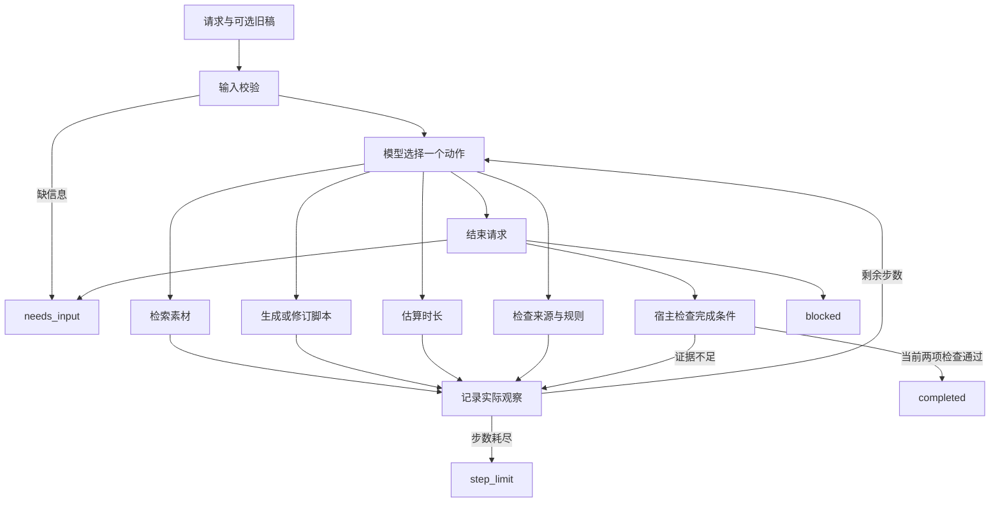

# 02 · 方案与动态决策

## 架构

`src/agent.py` 管理状态与上限，`src/providers.py` 接真实模型，`src/tools.py` 执行业务工具，`src/mock.py` 是单独标注的离线桩。项目未使用第三方 Agent 框架。

## 模型在决定什么

模型每次收到请求、当前稿件、已检索资料、最近检查结果和实际历史，输出一次 JSON 动作。动作包括检索、写稿、估时、查规则和结束。检索查询、镜头组合、引用事实、镜头停留时间与后续动作均来自模型响应。

宿主只负责执行所选动作、校验参数和阻止无证据完成，不在真实模型后端写死“失败就重试”的分支。Mock 有固定分支，但明确只作离线流程验证。

若模型选错工具、参数非法或试图提前完成，错误成为下一轮的观察；达到步数上限停止。网络错误属于模型不可用，不能继续假定决策，直接 blocked；不静默降级为 Mock。

## 三个工具

1. **search_materials**：对指定产品执行本地关键词检索，按匹配得分排序，最多返回五条。返回原文、来源 ID、事实 ID 和版本。产品范围由原请求绑定，模型只提供 query。不是向量检索；同义词能力有限，模型可改写查询。
2. **estimate_duration**：从实际文本计算，不能由模型自己填写总时长。每个汉字、英文单词、数字串为一个单位，按 4 单位/秒，加 0.5 秒停顿；镜头时长取旁白估算、hold_seconds、2 秒最短镜头三者最大值，向上取整到 0.1 秒后求和。只作中文短视频的粗略估计，未用真人配音校准。
3. **check_rules**：验证引用块逐字等于已检索事实；验证其他文案、标题和画面指令符合批准列表；检查禁用表达；返回逐块来源及风险位置。事实块缺失、错误来源、引用原文不符都不通过。

## 为什么限制文案

小型笔试项目内，通用语义事实核验很难通过几条正则可靠实现。因此采用受控文案组合：模型选择事实、组织镜头，连接语由可扩展品牌表提供。与无限制生成相比，创意和自然改写受限，但不会仅凭“引用了一个真实 ID”就认定整个句子有依据。

素材本身应由业务方核准。工具只证明输出忠实于输入资料，不证明资料在现实世界正确。当前数据都是明确标注的虚构产品信息。

## 检查与状态

- 每次 write_script 后，旧时长、旧规则检查全部失效。
- 两项检查带 SHA-256 稿件哈希，完成门禁同时核对通过标志、工具成功标志与当前稿件哈希。
- 目标时长来自原始请求，模型无法把 30 秒自行改为 60 秒；也不能让工具任意加快语速。
- `needs_input` 表示请求补充；`blocked` 表示明确无法继续；`step_limit` 表示预算用尽，保留未完成稿；`invalid_input` 表示输入格式错误。
- 最大 12 步默认，每步只执行一个动作。真实后端单次超时默认 180 秒；API 不自动重试，避免隐藏故障。

## 证据与复现

Trace 保存步骤、动作参数、工具原始结构化返回、简要决策依据和模型元数据。下一条 Trace 的动作就是上一条观察后的后续动作；不采集模型内部思维链。JSON 原文、资料快照和数据哈希共同支持复核。

Codex CLI 只是本项目的一个模型传输适配器，评审也可通过模型 API 使用相同决策协议。各次 CLI 调用临时、只读，模型不得调用宿主之外的工具。其自带上下文会增加开销，真实生产系统更适合直接 API。

官方接口参考：[Codex 非交互运行](https://developers.openai.com/codex/noninteractive/)、[结构化输出](https://developers.openai.com/api/docs/guides/structured-outputs)。
